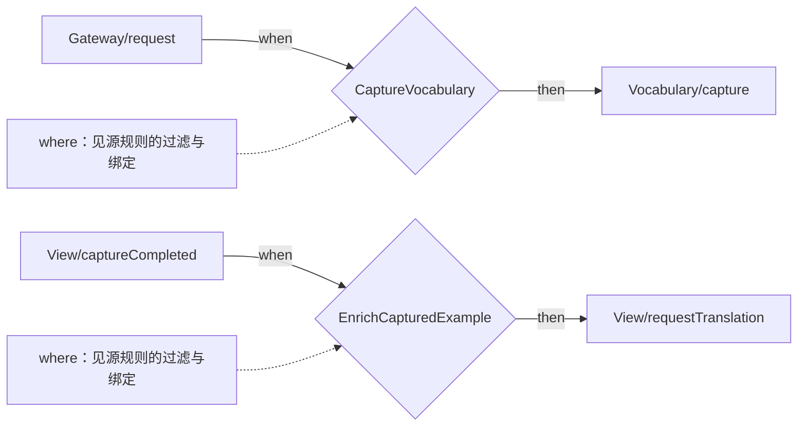
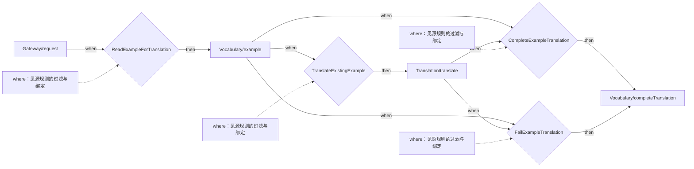
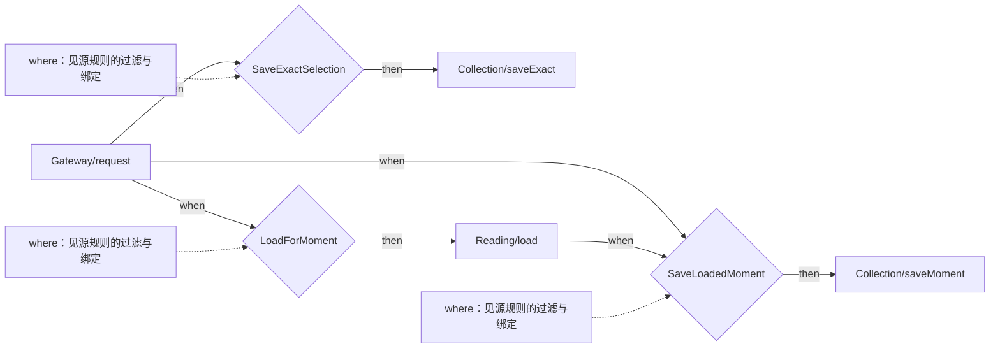
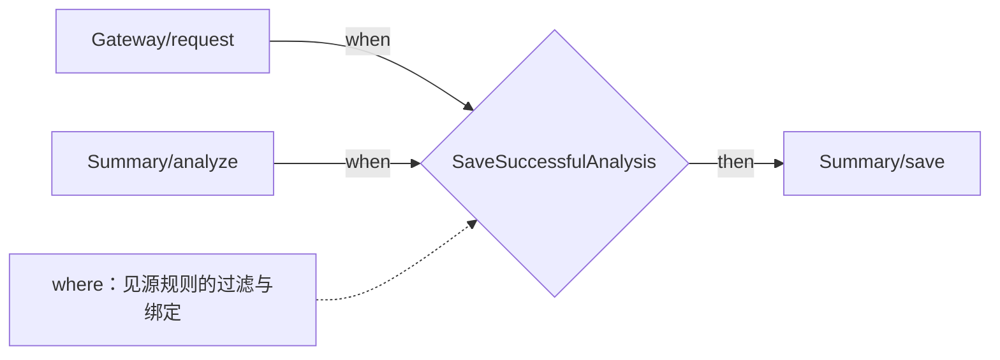
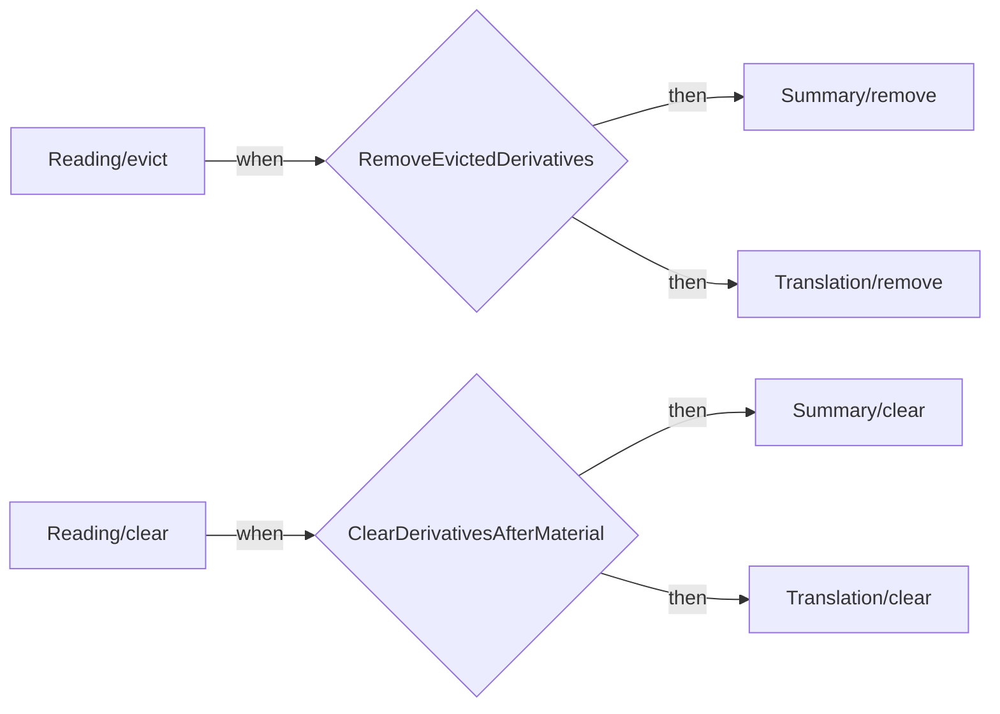
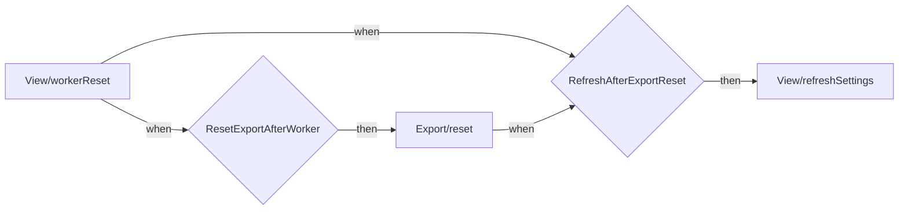
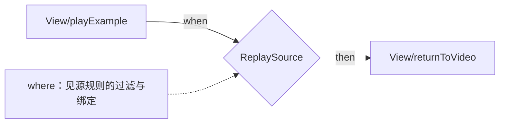

# 架构与规格导航

此文件由 `node scripts/check-specs.mjs --write-map` 从 CONCEPT/SYNCS 内容派生，勿手改。

## 扫描范围

覆盖 7 个 feature、Configuration、工作线程 mediator、页面补译/回放/重置协调及对应测试引用。
不扫描生成的 dist、node_modules 或历史研究。用途为实现回填推断，不代表产品设计适切性已证明。

## 概念索引

| 概念 | 用途 | 权威规格 |
| --- | --- | --- |
| Reading | 提供可按来源时间定位、选择和检索的字幕阅读材料。用途从阅读界面及公开服务归纳。 | [CONCEPT](src/features/reading/CONCEPT.md) |
| Vocabulary | 让学习者按一个英文词回看自己收藏过的原句和视频来源。用途从当前收藏与回放场景归纳。 | [CONCEPT](src/features/vocabulary/CONCEPT.md) |
| Translation | 把带稳定 ID 的文本片段译为中文，并保留原文与译文的对应关系。用途从分段翻译与双语视图归纳。 | [CONCEPT](src/features/translation/CONCEPT.md) |
| Explanation | 解释阅读时选中的文字在当前视频语境中的含义。用途从选区解释场景归纳。 | [CONCEPT](src/features/explanation/CONCEPT.md) |
| Summary | 提供带视频时间锚点的内容概览，帮助学习者找到章节与重点。用途从概览交互归纳。 | [CONCEPT](src/features/summary/CONCEPT.md) |
| Collection | 保留读者选中的内容或当前视频时刻的笔记，并能回到来源。用途从摘录场景归纳。 | [CONCEPT](src/features/collection/CONCEPT.md) |
| Export | 把用户选定的学习资料写入自己授权的本地目录。用途从 Markdown 导出场景归纳。 | [CONCEPT](src/features/export/CONCEPT.md) |
| Configuration | 保留用户选择的服务凭证和界面语言，并允许在保存前检查凭证能否连接服务。用途从设置页面归纳。 | [CONCEPT](src/modules/infrastructure/CONCEPT.md) |

## 同步地图

权威来源：[SYNCS](src/modules/syncs/SYNCS.md)。全部 25 个 mediator 路由在 route coverage 表中；
下图只展示 SYNCS 内显式命名规则。单动作路由、权限/重放中间件和 UI 导出回调不伪装为额外同步节点。

实线为 when 完成或 then 调用；虚线保留 where 过滤/绑定。多条 when 入边表示同一 flow 内的合取。
Gateway/View 是外部入口，矩形动作名均回溯到 include 契约；图不表示同步引擎已存在。

### capture-vocabulary

来源：[规则组](src/modules/syncs/SYNCS.md#capture-vocabulary)；可按下列 sync 名在 SYNCS 定位。

### enrich-vocabulary

来源：[规则组](src/modules/syncs/SYNCS.md#enrich-vocabulary)；可按下列 sync 名在 SYNCS 定位。

### capture-note

来源：[规则组](src/modules/syncs/SYNCS.md#capture-note)；可按下列 sync 名在 SYNCS 定位。

### summary

来源：[规则组](src/modules/syncs/SYNCS.md#summary)；可按下列 sync 名在 SYNCS 定位。

### cache

来源：[规则组](src/modules/syncs/SYNCS.md#cache)；可按下列 sync 名在 SYNCS 定位。

### reset

来源：[规则组](src/modules/syncs/SYNCS.md#reset)；可按下列 sync 名在 SYNCS 定位。

### replay-source

来源：[规则组](src/modules/syncs/SYNCS.md#replay-source)；可按下列 sync 名在 SYNCS 定位。

## 边界、覆盖与未决项

- gateway：浏览器协议适配；syncs：协调；shared：类型；app：装配，均不因有目录就成为业务概念。Configuration 是 infrastructure 中独立拥有设置状态的例外。
- 15 个命名同步规则均来自 SYNCS；路由表覆盖 25 个 apply 分支。静态检查验证名称、路由覆盖和本地引用，不验证参数/失败语义或模型适切性。
- 本次没有创建 PIPELINE；用户范围是概念与同步。网络/构建技术流水线不据此获得新的业务契约。
- 未发现独立总体 PRD，故不生成产品依赖矩阵；不得从调用或同步边推断产品依赖。README 只作为当前场景用途的出处。
- 已知限制与修复方向集中在 [SYNCS 的 observed limits](src/modules/syncs/SYNCS.md#view-local-composition-and-observed-limits)：跨库部分完成、有限重放窗口、epoch 非原子取消、Export 回调耦合。
