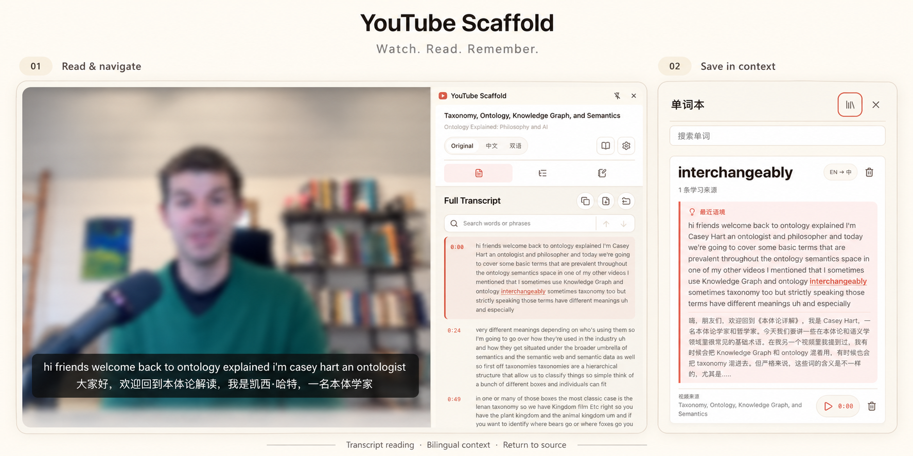

参考并改写自 [Zara Zhang](https://github.com/zarazhangrui) 的 [YouTube Digest](https://github.com/zarazhangrui/youtube-digest)，保留原作者的 [MIT许可](https://github.com/AgenticWeb4/youtube-scaffold/blob/main/LICENSE)。第三方依赖及随包许可证见 [NOTICE](https://github.com/AgenticWeb4/youtube-scaffold/blob/main/NOTICE)。

# YouTube Scaffold

在YouTube视频旁阅读字幕、查看双语译文、理解重点，并保存可回到来源的笔记和单词。

- 按时间戳阅读、搜索字幕并定位视频。
- 切换原文、中文或双语视图，按需生成概览和语境解释。
- 保存片段笔记，或收藏带双语语境与视频时间的英文单词。
- 再次遇见收藏词时高亮，回到来源重听。
- 导出字幕TXT，以及包含概览、字幕与笔记的Markdown。

## 用看过的视频记单词

比如，你在编程教程里遇到 approach（方法），又在一段访谈里听到这个词。把两次遇见都收藏后，单词本会把它们放在一起，保留原句、中文译文和视频位置。复习时点一下，就能回到当时的视频，再听一遍这个词是怎么用的。



*界面节选合成，已对无关画面作模糊处理。*

## 相比原版增强了什么

对照 [YouTube Digest v1.2.0 的代码基线](https://github.com/zarazhangrui/youtube-digest/tree/bb2f7b1aedb6b50c261c0cf35b0acc7ed631d833)。原版已经提供字幕阅读与搜索、双语视图、AI 概览、选区解释、时间戳笔记和字幕 TXT 导出；本项目保留这些能力，并围绕情景记忆与学习资料整理继续扩展。

| 方向 | YouTube Digest 原版 | YouTube Scaffold 的增强 |
| --- | --- | --- |
| 情景单词本 | 在后续改造建议中提出生词本，尚未提供对应功能 | 收藏英文整词时保存原句、已有中文译文和视频位置；同一词在不同视频中的收藏聚合到一张词卡 |
| 回到语境复习 | 通过字幕、概览或笔记的时间戳定位视频 | 增加收藏词整词高亮、按词检索来源和逐条例句回放；当前视频直接定位，其他视频在新标签打开 |
| 原句与译文保存 | 已有字幕与界面翻译缓存 | 单词例句另存独立快照，清理视频缓存后仍保留；缺少译文时先保存原句，再补译，失败可以重试 |
| 学习资料导出 | 导出字幕 TXT | 保留 TXT，增加 Markdown 导出；可选择概览、字幕和笔记，保存到用户授权的本地目录，并附来源时间链接 |
| 服务设置 | 填写并保存 Supadata、DeepSeek Key | 增加保存前的连接测试，分别反馈认证失败、限流、超时等结果；测试不会保存输入的 Key |
| 词本交互 | 未提供单词本界面 | 支持词卡检索、展开多个来源、删除单个例句或整词，以及可拖动、限制在窗口内的词本对话框 |

单词本只聚合用户主动收藏的出现位置。它目前不提供自动搜集所有视频、词形合并、Anki 导出或间隔复习；视频定位采用字幕片段时间。

## 架构上做了哪些重构

原版采用无需构建的 HTML/CSS/JavaScript，主要逻辑位于 `background.js`、`sidepanel.js`、`options.js` 等入口脚本。本项目改为 pnpm workspace，按功能职责拆分模块，通过 TypeScript 项目引用和 esbuild 构建扩展；保留部分 JavaScript 实现。

| 方面 | 原版组织方式 | 本项目组织方式与目的 |
| --- | --- | --- |
| 功能边界 | 阅读、翻译、概览、笔记等逻辑分布在后台与面板脚本中 | 拆为 Reading、Vocabulary、Translation、Explanation、Summary、Collection、Export 七个功能模块，各自暴露公开接口，便于独立修改与验证 |
| 模块内部职责 | 以浏览器入口脚本为主要组织单位 | 将业务规则、应用服务、外部适配与界面展示按职责分开；业务功能不互相导入，Chrome、网络与存储细节通过适配器接入 |
| 跨功能协调 | 由各入口脚本安排功能调用 | 在 `syncs` 中集中表达收藏、补译、组合缓存和重置顺序；由应用入口装配依赖，功能模块维护自己的状态 |
| 数据写入 | 后台、面板与设置脚本直接读写 Chrome 存储 | 字幕、AI 缓存、笔记、词本与服务设置的持久化写入通过工作线程和所属模块；本地目录导出保留在扩展页执行，以保有文件选择所需的用户手势 |
| 异步执行 | 各功能脚本处理请求与回调 | 协调层集中处理请求关联、在途合并、有限窗口的重放抑制和重置世代检查，降低重复操作与迟到结果回写的风险 |
| 规格维护 | README、隐私说明和代码描述产品行为 | 模块旁保留 `CONCEPT.md`，协调层保留 `SYNCS.md`，从规格派生架构导航；行为变更时将规格、实现和必要测试一起提交 |
| 验证与交付 | 已有自动测试、发行包检查和 CI 打包校验 | 增加类型、静态依赖边界、规格覆盖与引用检查；CI 提供可下载安装包，版本标签触发 Release，并附 SHA-256 校验文件 |

工作线程中的主要调用路径：

```text
浏览器消息 → gateway（入口校验与协议适配）
          → syncs（跨功能协调）
          → 功能模块的公开动作 → 各自的存储或服务适配器
```

页面可直接使用无持久化副作用的阅读、对齐工具；目录导出是上述工作线程路径之外的页面功能。这里的同步规则由现有代码执行，`SYNCS.md` 用于说明契约与因果关系，没有引入额外同步引擎。跨模块重置仍可能部分完成，重放抑制也有保留窗口；这些边界见 [架构与规格导航](ARCHITECTURE.md) 及其链接的同步规格。

## 安装

需要Chrome 116或更新版本。

1. 从 [最新 Release](https://github.com/AgenticWeb4/youtube-scaffold/releases/latest) 下载扩展ZIP并解压到固定目录。
2. 打开 `chrome://extensions`，启用开发者模式。
3. 选择“加载已解压的扩展程序”，打开解压后包含 `manifest.json` 的目录。

更新后重新加载扩展并刷新YouTube；保留原加载目录可继续使用已有设置和收藏。

从源码构建时，需要Node.js 22或更新版本及项目指定版本的pnpm：

```sh
pnpm install --frozen-lockfile
pnpm run build
```

构建后，在Chrome加载 `dist/extension/`。

## 开始使用

1. 在设置中填写自己的 [Supadata](https://dash.supadata.ai/) 和 [DeepSeek](https://platform.deepseek.com/) API Key，可先测试连接。
2. 打开有字幕的标准YouTube视频页面，点击扩展图标。
3. 阅读或翻译字幕；打开概览，或选中文字进行解释和摘录。
4. 选中英文整词加入单词本，点击词卡播放按钮回到视频来源。
5. 按需导出学习资料。

服务费用由对应服务商收取，本项目不提供API额度。无可用字幕时不自动生成转写；时间定位依据字幕片段。单词本保存在本机，暂不支持云同步、文件导出或复习算法。

## 数据与安全

API请求直接发往Supadata与DeepSeek，本项目不提供中转服务、广告或使用情况追踪。Key只填写在扩展设置中，不写入源码、截图或Issue。数据保留、删除和权限范围见 [隐私说明](PRIVACY.md)。

## 检查与打包

```sh
pnpm run check
pnpm run package
```

安装包生成在 `dist/`；构建产物与本地数据不提交到Git。

概念契约与同步规格随源码维护：从 [架构与规格导航](ARCHITECTURE.md) 进入各模块的 `CONCEPT.md` 及协调层的 `SYNCS.md`。`pnpm run check` 会检查规格覆盖、引用与派生地图；更新规格后运行 `pnpm run specs:map` 重建导航。行为变更应在同一次提交中更新对应规格、实现及必要测试。

推送代码或提交PR时，GitHub Actions会自动测试、构建并提供安装包。推送与项目版本一致的 `vX.Y.Z` 标签后，会自动发布到 Releases；也可在 Actions 页面手动运行构建。
